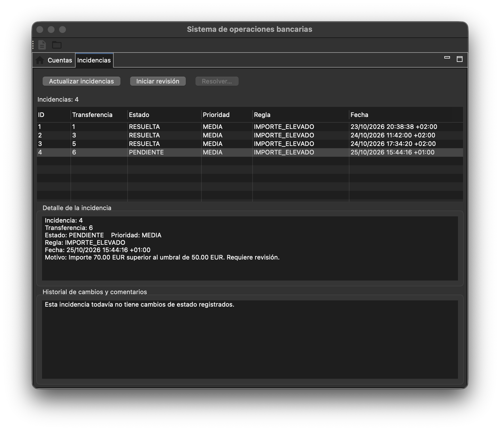
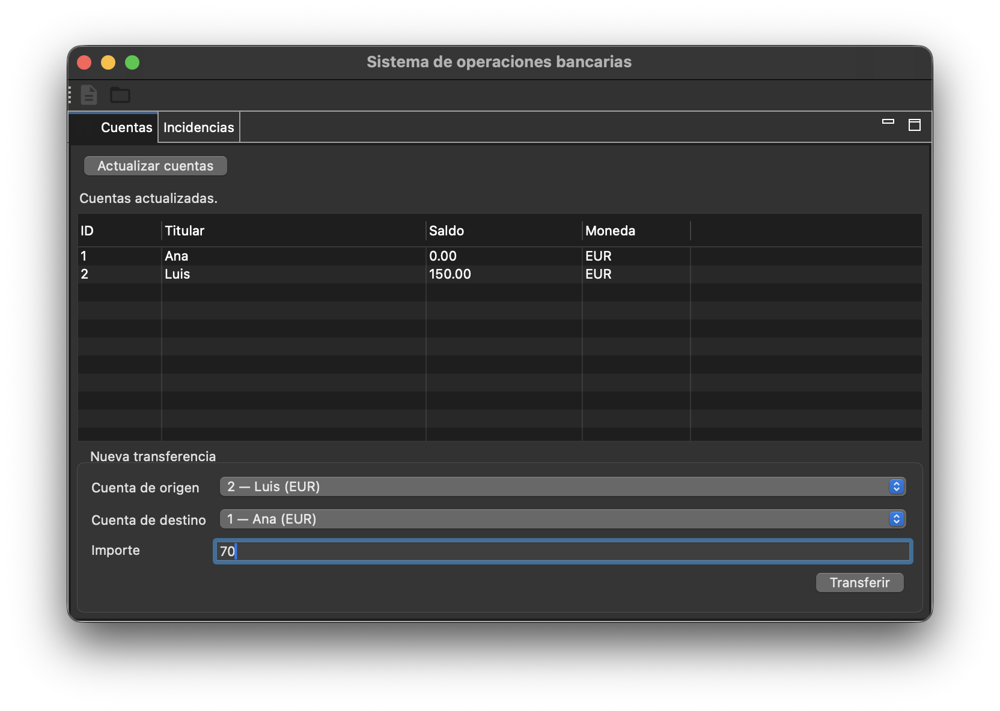
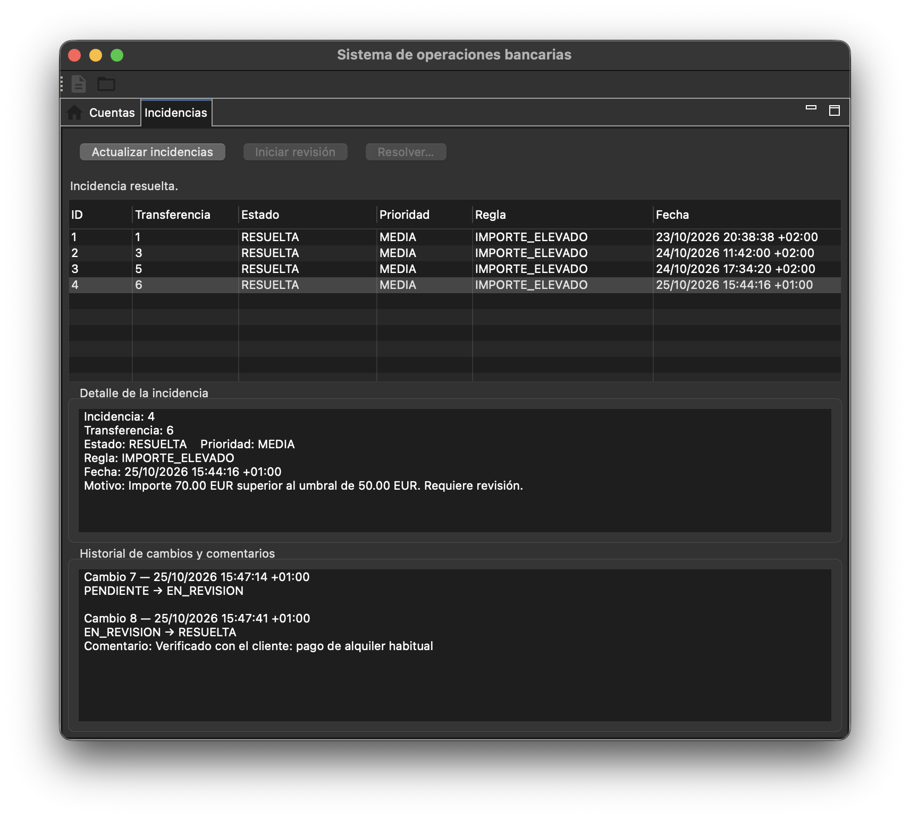

# Countercheck — Sistema de operaciones bancarias

Backend en **Java 17 + Spring Boot** y cliente de escritorio en **Eclipse RCP** para
simular el trabajo de back office de un banco: transferencias entre cuentas,
detección automática de operaciones sospechosas y gestión de las incidencias que
generan, con historial de cada cambio. Integración continua con **Jenkins**.

> 📸 **Captura pendiente:** vista general del cliente RCP (pestaña Incidencias).
<!--  -->

## Qué hace

- **Cuentas y transferencias**: saldos en SQL, importes con `BigDecimal`, validación
  de saldo, moneda y cuentas, y bloqueo de filas para evitar dobles gastos concurrentes.
- **Detección de anomalías**: una regla configurable marca las transferencias que
  superan un umbral y crea una incidencia en la misma transacción.
- **Gestión de incidencias**: flujo `PENDIENTE → EN_REVISION → RESUELTA`, resolución
  con comentario obligatorio e historial fechado de cada cambio de estado.
- **Cliente de escritorio para empleados** (Eclipse RCP): consulta de cuentas,
  formulario de transferencias, revisión y resolución de incidencias.
- **CI con Jenkins**: cada cambio en `main` ejecuta las pruebas, publica los
  informes JUnit y archiva el JAR si todo pasa.

## Stack

| Área | Tecnologías |
|---|---|
| Backend | Java 17, Spring Boot 3.5 (Web, Validation, JDBC), API REST |
| Datos | SQL con `JdbcTemplate` (sin ORM), H2 en archivo, transacciones y `SELECT FOR UPDATE` |
| Escritorio | Eclipse RCP (e4), SWT, cliente HTTP contra la API |
| Calidad | JUnit 5, MockMvc, pruebas de concurrencia, rollback y persistencia (51 pruebas) |
| CI | Jenkins (Pipeline desde SCM) en Docker, Maven Wrapper, Git |

## Arquitectura

```text
Cliente RCP (empleado) ──HTTP/JSON──► BancoController
                                          │
                                     BancoService (@Transactional)
                                     ├─ ServicioTransferencias  (reglas de negocio en Java puro)
                                     ├─ ReglaImporteElevado     (detección)
                                     └─ Repositorios JDBC ──► H2 (cuentas, transferencias,
                                                                  incidencias, cambios_incidencia)
```

Una transferencia bloquea ambas cuentas en orden de ID, aplica las reglas, guarda
saldos y movimiento, evalúa la detección y registra la incidencia. Todo se confirma
o se revierte junto.

## Capturas

> 📸 **Captura pendiente:** pestaña Cuentas con el formulario de transferencia.
<!--  -->

> 📸 **Captura pendiente:** resolución de una incidencia con comentario e historial.
<!--  -->

> 📸 **Captura pendiente:** ejecución de Jenkins con los resultados de las pruebas.
<!--  -->

## Arrancar

Requisitos: Java 17 o superior. No hace falta instalar Maven ni una base de datos.

```sh
./mvnw spring-boot:run
```

El servidor escucha en `http://localhost:8080` (solo en local). En Windows usa
`mvnw.cmd`. Los datos se guardan en `data/banco.mv.db` y se conservan entre reinicios.
La primera vez se crean dos cuentas de ejemplo: Ana (ID 1, 100 EUR) y Luis (ID 2, 50 EUR).

Para el cliente de escritorio, consulta [banco.desktop/README.md](banco.desktop/README.md).

## API

| Método | Ruta | Descripción |
|---|---|---|
| GET | `/api/cuentas` | Cuentas y saldos |
| POST | `/api/transferencias` | Realiza una transferencia |
| GET | `/api/transferencias` | Historial de transferencias |
| GET | `/api/incidencias` | Incidencias detectadas |
| GET | `/api/incidencias/{id}` | Detalle de una incidencia |
| GET | `/api/incidencias/{id}/historial` | Cambios de estado con fecha y comentario |
| POST | `/api/incidencias/{id}/revision` | `PENDIENTE → EN_REVISION` |
| POST | `/api/incidencias/{id}/resolucion` | `EN_REVISION → RESUELTA` (comentario obligatorio) |

Errores en JSON: `400` datos inválidos, `404` recurso inexistente, `409` cambio de
estado no permitido.

```sh
# Transferencia de 60 EUR: supera el umbral (50 EUR) y genera una incidencia
curl -i localhost:8080/api/transferencias \
  -H 'Content-Type: application/json' \
  -d '{"cuentaOrigenId":1,"cuentaDestinoId":2,"importe":60.00}'

curl -i -X POST localhost:8080/api/incidencias/1/revision

curl -i localhost:8080/api/incidencias/1/resolucion \
  -H 'Content-Type: application/json' \
  -d '{"comentario":"Transferencia revisada; operación justificada."}'

curl localhost:8080/api/incidencias/1/historial
```

## Pruebas

```sh
./mvnw test      # pruebas
./mvnw verify    # pruebas + empaquetado
```

- `ServicioTransferenciasTest`: reglas de negocio sin Spring.
- `BancoApiTest`: rutas, JSON y errores con MockMvc.
- `BancoPersistenciaTest`: SQL, rollback y transferencias concurrentes.
- `ReinicioPersistenciaTest`: los datos sobreviven a un reinicio.
- `ReglaImporteElevadoTest`: límites del umbral y moneda.
- `IncidenciasTest`: generación, transiciones de estado, historial y rollback.

Las pruebas usan bases aisladas y no modifican los datos de demostración.

## Integración continua

El [Jenkinsfile](Jenkinsfile) ejecuta `clean verify`, publica los informes JUnit y
archiva el JAR solo si todo pasa. Jenkins consulta GitHub cada cinco minutos.
Guía de instalación local con Docker: [docs/jenkins.md](docs/jenkins.md).

## Decisiones técnicas

- **JDBC con SQL explícito en vez de JPA**: control total sobre las consultas y
  los bloqueos, y SQL fácil de revisar.
- **Bloqueo de filas en orden de ID**: evita gastar dos veces el mismo saldo y
  previene interbloqueos entre transferencias cruzadas.
- **`BigDecimal` y `DECIMAL(19,2)`**: sin errores de redondeo en importes.
- **Detección y movimiento en la misma transacción**: no puede existir una
  transferencia marcada sin su incidencia, ni al revés.
- **Cambio de estado condicionado al estado previo**: dos revisores simultáneos no
  pueden aplicar la misma transición dos veces.

## Limitaciones y próximos pasos

Es un proyecto de demostración. El umbral de 50 EUR es didáctico, no un criterio real.

- [ ] Autenticación y roles con Spring Security
- [ ] Contenedor Docker y despliegue en servidor Linux
- [ ] Despliegue automático desde Jenkins (CD)
- [ ] Importación y validación de ficheros de datos con incidencias de calidad
- [ ] Migraciones de esquema con Flyway y soporte para SQL Server / Oracle
- [ ] Paginación e idempotencia en las transferencias
